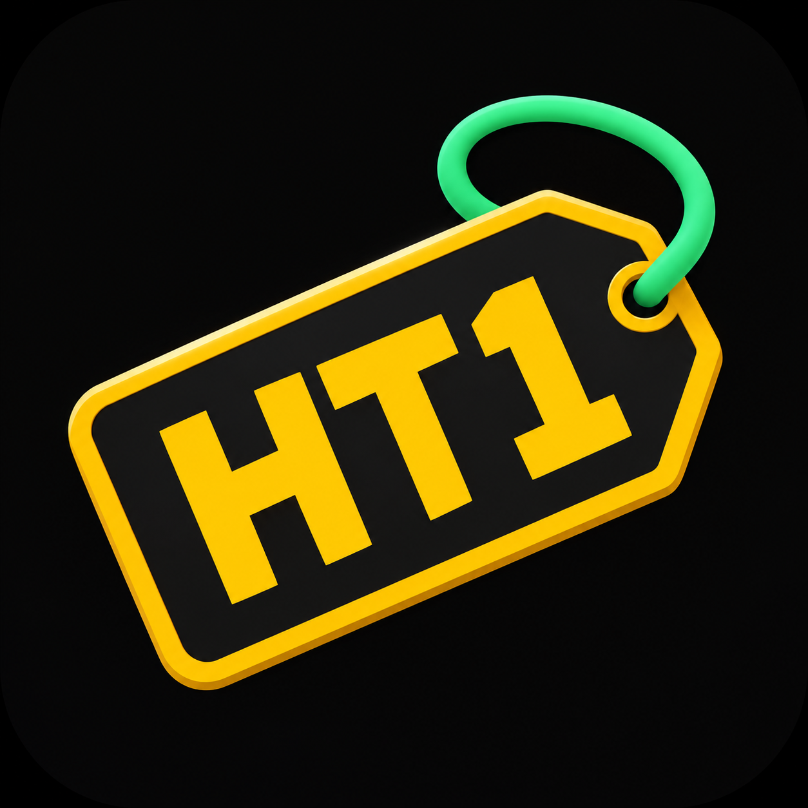

  

# Crit's Tier Tagger

A client-side Fabric mod for **Minecraft Java 26.2**. Display PvP tiers from **AfriTiers, MCTiers, PvPTiers or SubTiers**, search player profiles, and watch AfriTiers waitlists.

- One selected tierlist for player nametags and Tab, with smooth mode icons and tier colours.
- A themed workspace with 14 presets, custom palettes, tier-colour controls, automatic saving and a provider-specific mode picker.
- Profiles with a separate tierlist selector, region, points, overall rank and per-mode tiers.
- AfriTiers waitlist alerts in chat, optional sound and available Discord join links.
- AfriTiers username matching and paid-name recovery; verified UUID matching for the other tierlists.

## Install

Download [crits-tier-tagger-2.3.2.jar](releases/crits-tier-tagger-2.3.2.jar). Check its SHA-256 against [SHA256SUMS.txt](releases/SHA256SUMS.txt), and see the [changelog](CHANGELOG.md) for release details.

| Requirement | Version |
| --- | --- |
| Minecraft Java | 26.2 |
| Java | 25 |
| Fabric Loader | 0.19.5+ |
| Fabric API | 0.161.0+26.2 |
| Mod Menu, optional | 20.0.3 |

Install [Fabric Loader](https://fabricmc.net/use/installer/) and [Fabric API](https://modrinth.com/mod/fabric-api/versions?g=26.2), then put the JAR in your client's `mods` folder. **Remove the older AfriTiers Tier Tagger JAR when upgrading.** Servers and other players do not need the mod.

The mod keeps its original internal ID and `config/afritiers_tagger.json` file so existing settings, aliases, keybinds and waitlist subscriptions carry over. AfriTiers remains the default provider for existing installations. Install only one version at a time.

## Settings and tierlists

Press **K**, run `/crittiers config`, or open **Mods → Crit's Tier Tagger → Configure**. Changes save immediately. Close with Done or Escape; invalid colour values are not saved.

The GUI uses an inset workspace with rounded, translucent panels and four side tabs: **Tier Tags**, **Profiles**, **Waitlists** and **Settings**. Smaller GUI sizes keep the sidebar and scroll the content. Profiles retains its centred identity, overall position and continuous panel of mode icons with coloured tier pills.

In **Settings → Themes**, choose from 14 palettes: Frosted, Glass, Obsidian, Minecraft, Mauve, Rose, Latte, Nordic, Snow, Ember, Forest, Abyss, Linen and Cherry. Each card previews its own palette without descriptive subtitles. In **Settings → Interface**, choose transparent or opaque panels, adjust opacity (60% by default) and corner radius, pick an accent swatch or enter a hex value, and toggle blur, motion or smooth text and rounded edges. The Minecraft preset starts with square corners and pixel text; its font can also be switched to Outfit. Blur follows Minecraft's Menu Background Blur setting; animations also respect its Screen Effects preference. GUI font and palette preferences never replace Minecraft's HUD font.

**Settings → Tier colours** edits the five tier colours, with live previews and four colour sets. High, low and retired tiers share their tier number's colour. An optional all-tags override applies to Tab and nametags; Profiles keeps the individual tier colours. Colour editing is available here only; Tier Tags contains visibility, provider and mode controls. Blank fields restore defaults; unfinished hex values keep the last saved colour.

**Settings → Custom** lets you override background, sidebar, surface, text, muted text and borders on top of a preset. Enable Custom palette to use these overrides. Copy theme and Paste theme share only appearance preferences, without usernames, aliases or account data. Appearance and tier palettes have separate resets. Selecting a preset restores its accent and opacity, and turns off custom palette overrides while keeping them available for later.

Choose the in-game tierlist directly in **Tier Tags**, using the four provider buttons. This source supplies both Tab and nametags. Each provider remembers its selected mode; choose a specific mode or Strongest tier below the selector. Providers remain separate: an outage or missing player does not substitute another tierlist's result. Profiles has its own independent source selector.

Settings and Profiles work from the main menu through Mod Menu or the **K** shortcut; joining a world is not required. The title-screen shortcut follows your configured keybind and works without Mod Menu. Opening Tier Tags loads the selected tierlist, and selecting another source starts its update immediately. Background refreshes and API cooldowns still apply. Mode and provider artwork uses the original assets, with no redrawing or recolouring.

Retired tiers are included by default. Tier colours are gold for tier 1, silver for tier 2, bronze for tier 3 and purple for tiers 4–5. A custom colour affects tags; profile stats keep tier colours. The preview starts with Sword HT1. Tab and nametags show the mode icon and tier without ranking labels or rank indentation. Tags use spaces with no added pipe separator.

| Tierlist | Data source | Points and ranking |
| --- | --- | --- |
| [AfriTiers](https://afritiers.co.za) | Public players API | Overall placement calculated from active-tier points; retired tiers earn zero |
| [MCTiers](https://mctiers.net) | Public v2 UUID profile and mode APIs | Provider-supplied points and overall placement |
| [PvPTiers](https://pvptiers.com) | Public UUID profile API; eight bundled mode choices | Provider-supplied points and overall placement |
| [SubTiers](https://subtiers.net) | Public v2 UUID profile and mode APIs | Provider-supplied points and overall placement |

For MCTiers, PvPTiers and SubTiers, player names first resolve through the official Minecraft account service. Tierlist requests and matching then use only that verified account UUID. Account resolution is shared across all three sources and cached for five minutes; tier profiles have separate per-provider UUID caches. Missing accounts/profiles are cached briefly; failures and rate limits retry with a cooldown. A busy server can take longer to populate. Requests run in the background. No API key is required.

Joining a server, changing worlds, respawning or transferring between hubs and practice servers schedules a refresh. Rapid transfers share pending work and respect API cooldowns. Cached tiers stay visible while a transfer refresh waits to run.

## Profiles and usernames

**Profiles** initially displays your own account and leaves the search box empty. Select a tierlist, then search a username with Search or Enter. My profile returns to your account and clears the box. Choosing a source here does not change in-game tags. `/tiers <player> [tierlist]` opens a search directly.

External providers supply their own points and overall ranks; missing stats display as not supplied. AfriTiers combat titles are specific to AfriTiers. Retired tiers use an `R` prefix everywhere, for example `RHT1` or `RLT2`, with the same colour as the underlying tier. Your account uses its skin; other players use an available online skin or a labelled default skin.

AfriTiers retains username matching for offline/cracked accounts, verified paid-account rename recovery and saved username aliases. Its matching behavior is unchanged.

MCTiers, PvPTiers and SubTiers use verified Minecraft-account UUIDs for Tab, nametags and Profiles. This also works on offline-mode servers because **server-generated UUIDs are ignored**. Accounts without a verified official UUID receive no external-provider tier. A tierlist's old display name does not prevent a match when its UUID is correct; a mismatched or missing UUID is rejected. There is no tierlist username fallback. Username aliases apply only to AfriTiers; legacy external-provider alias entries are ignored.

| Command | Action |
| --- | --- |
| `/tiers` | Open your own profile with an empty search box |
| `/tiers <player> [tierlist]` | Search a profile; tierlist is `afritiers`, `mctiers`, `pvptiers` or `subtiers` |
| `/crittiers config` | Open settings |
| `/crittiers refresh` | Refresh the selected in-game tierlist, subject to its cooldown |
| `/crittiers status [username]` | Show selected-provider connection or player details |
| `/crittiers alias set <current> <apiName>` | Save an AfriTiers alias while AfriTiers is selected |
| `/crittiers alias remove <current>` | Remove an AfriTiers alias |
| `/crittiers alias list` | List AfriTiers aliases |

`/ctiers` and the original `/afritiers` support the same settings, status, refresh and alias subcommands.

## AfriTiers waitlists

**Waitlists** always uses the [AfriTiers queues API](https://afritiers.co.za/api/queues), independently of the selected tierlist or tag visibility. Choose the modes you want to watch; none are selected by default. All/None change the selection, Notifications pauses alerts without clearing it, and Sound controls the chime. Choices save automatically.

Queues are checked about every 30 seconds while watching in game or browsing this tab. Selected queues notify once per opening, including queues already open at the first sync. A new API event can trigger another alert. Available Discord links appear as a clickable Join action. Alerts are delivered only in game; stale responses and API errors do not trigger alerts.

## Build

Use JDK 25 and run `./gradlew build`, or `.\gradlew.bat build` on Windows. The production JAR is written to `build/libs/crits-tier-tagger-2.3.2.jar`.

The repository includes production source, canonical runtime assets, build files, provenance documentation and the latest packaged JAR. See [Codebase layout](docs/CODEBASE.md) for the source map. Local verification tools, fixtures and debug files are excluded.

## License

All rights reserved. See [LICENSE](LICENSE). Third-party names, logos and mode icons belong to their respective owners; original asset links are in [docs/PROVIDERS.md](docs/PROVIDERS.md) and [docs/MODES.md](docs/MODES.md). This project is independent of the listed tierlist services.

Outfit is by The Outfit Project Authors, licensed under the SIL Open Font License 1.1. The bundled font license is included in the mod assets.
