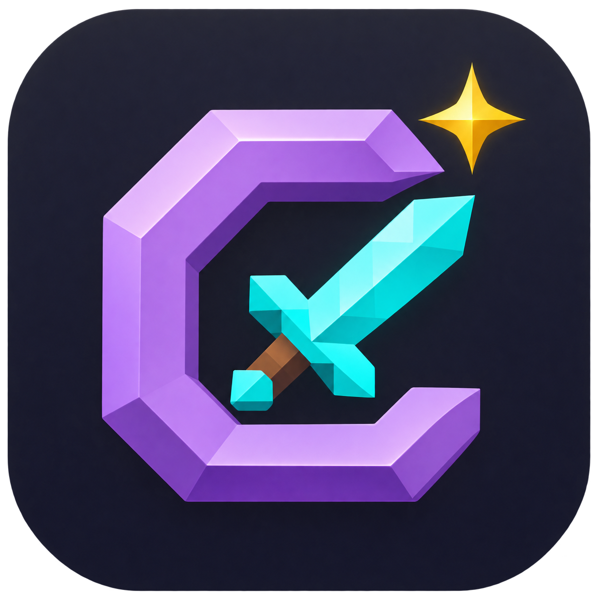

  

# Crit's Tier Tagger

A client-side Fabric mod for **Minecraft Java 26.2**. Display PvP tiers from **AfriTiers, MCTiers, PvPTiers or SubTiers**, search player profiles, and watch AfriTiers waitlists.

- One selected tierlist for player nametags and Tab, with smooth mode icons and tier colours.
- Transparent settings with automatic saving and a provider-specific mode picker.
- Profiles with a separate tierlist selector, region, points, overall rank and per-mode tiers.
- Optional gold `#1`–`#10` overall labels; Tab alignment applies only to top-ten players.
- AfriTiers waitlist alerts in chat, optional sound and available Discord join links.
- Username matching for offline accounts, AfriTiers paid-name recovery and provider-specific aliases.

## Install

Download [crits-tier-tagger-2.0.1.jar](releases/crits-tier-tagger-2.0.1.jar). Check its SHA-256 against [SHA256SUMS.txt](releases/SHA256SUMS.txt), and see the [changelog](CHANGELOG.md) for release details.

| Requirement | Version |
| --- | --- |
| Minecraft Java | 26.2 |
| Java | 25 |
| Fabric Loader | 0.19.5+ |
| Fabric API | 0.161.0+26.2 |
| Mod Menu, optional | 20.0.3 |

Install [Fabric Loader](https://fabricmc.net/use/installer/) and [Fabric API](https://modrinth.com/mod/fabric-api/versions?g=26.2), then put the JAR in your client's `mods` folder. **Remove the older AfriTiers Tier Tagger JAR when upgrading.** Servers and other players do not need the mod.

The mod keeps its original internal ID and `config/afritiers_tagger.json` file so existing settings, aliases, keybinds and waitlist subscriptions carry over. AfriTiers remains the default provider for existing installations. Install only one version at a time.

## Settings and tierlists

Press **K**, run `/crittiers config`, or open **Mods → Crit's Tier Tagger → Configure**. Changes save immediately. Close with Done or Escape; invalid colour values are not saved.

Choose your in-game source in **Tierlists**. This supplies both Tab and nametags. Each provider remembers its selected mode; choose a specific mode or Strongest tier from Settings. Providers remain separate: an outage or missing player does not substitute another tierlist's result.

Settings and Profiles work from the main menu through Mod Menu or the **K** shortcut; joining a world is not required. The title-screen shortcut follows your configured keybind and also works without Mod Menu. Opening Settings loads the selected tierlist, and selecting another source starts its update immediately. Profiles can display your account or search any username from the main menu. Background refreshes and API cooldowns still apply. Provider choices show each service's own logo; mode icons use simple flat artwork inspired by the tierlists' visual style.

Retired tiers are included by default. Top 10 rank is off by default and uses the selected provider's **overall** leaderboard position. Tier colours are gold for tier 1, silver for tier 2, bronze for tier 3 and purple for tiers 4–5. A custom colour affects tags; profile stats keep tier colours. The preview starts with Sword HT1 and gold #1. Tags use spaces with no added pipe separator.

| Tierlist | Data source | Points and ranking |
| --- | --- | --- |
| [AfriTiers](https://afritiers.co.za) | Public players API | Overall placement calculated from active-tier points; retired tiers earn zero |
| [MCTiers](https://mctiers.net) | Public v2 username profile and mode APIs | Provider-supplied points and overall placement |
| [PvPTiers](https://pvptiers.com) | Public username profile API; eight bundled mode choices | Provider-supplied points and overall placement |
| [SubTiers](https://subtiers.net) | Public v2 username profile and mode APIs | Provider-supplied points and overall placement |

For MCTiers, PvPTiers and SubTiers, visible players are looked up gradually and cached for five minutes. Missing profiles are cached briefly; failures and rate limits retry with a cooldown. A busy server can take longer to populate. Requests run in the background. No API key is required.

Joining a server, changing worlds, respawning or transferring between hubs and practice servers schedules a refresh. Rapid transfers share pending work and respect API cooldowns. Cached tiers stay visible while a transfer refresh waits to run.

## Profiles and usernames

**Profiles** initially displays your own account and leaves the search box empty. Select a tierlist, then search a username with Search or Enter. My profile returns to your account and clears the box. Choosing a source here does not change in-game tags. `/tiers <player> [tierlist]` opens a search directly.

External providers supply their own points and overall ranks; missing stats display as not supplied. AfriTiers combat titles are specific to AfriTiers. Profiles label retired tiers. Your account uses its skin; other players use an available online skin or a labelled default skin.

Offline/cracked accounts match by username. AfriTiers can recover paid-account name changes using verified paid IDs in its records and Mojang's current-name service. The other tierlists are queried by username. **Server/offline UUIDs are never used for tier matching.** If a provider still has an old name, save a known alias while that provider is selected. Aliases belong to that provider and do not affect the others.

| Command | Action |
| --- | --- |
| `/tiers` | Open your own profile with an empty search box |
| `/tiers <player> [tierlist]` | Search a profile; tierlist is `afritiers`, `mctiers`, `pvptiers` or `subtiers` |
| `/crittiers config` | Open settings |
| `/crittiers refresh` | Refresh the selected in-game tierlist, subject to its cooldown |
| `/crittiers status [username]` | Show selected-provider connection or player details |
| `/crittiers alias set <current> <apiName>` | Save an alias for the selected in-game provider |
| `/crittiers alias remove <current>` | Remove that provider's alias |
| `/crittiers alias list` | List that provider's aliases |

`/ctiers` and the original `/afritiers` support the same settings, status, refresh and alias subcommands.

## AfriTiers waitlists

**Waitlists** always uses the [AfriTiers queues API](https://afritiers.co.za/api/queues), independently of the selected tierlist or tag visibility. Choose the modes you want to watch; none are selected by default. All/None change the selection, Notifications pauses alerts without clearing it, and Sound controls the chime. Choices save automatically.

Queues are checked about every 30 seconds while watching in game or browsing this tab. Selected queues notify once per opening, including queues already open at the first sync. A new API event can trigger another alert. Available Discord links appear as a clickable Join action. Alerts are delivered only in game; stale responses and API errors do not trigger alerts.

## Build

Use JDK 25 and run `./gradlew build`, or `.\gradlew.bat build` on Windows. The production JAR is written to `build/libs/crits-tier-tagger-2.0.1.jar`.

The repository includes production source, assets, build files, editable mode artwork in `artwork/modes/`, and the latest packaged JAR. Local verification tools, fixtures and debug files are excluded.

## License

All rights reserved. See [LICENSE](LICENSE). Provider names and logos belong to their respective owners; original asset links are in [artwork/PROVIDERS.md](artwork/PROVIDERS.md). This project is independent of the listed tierlist services.
